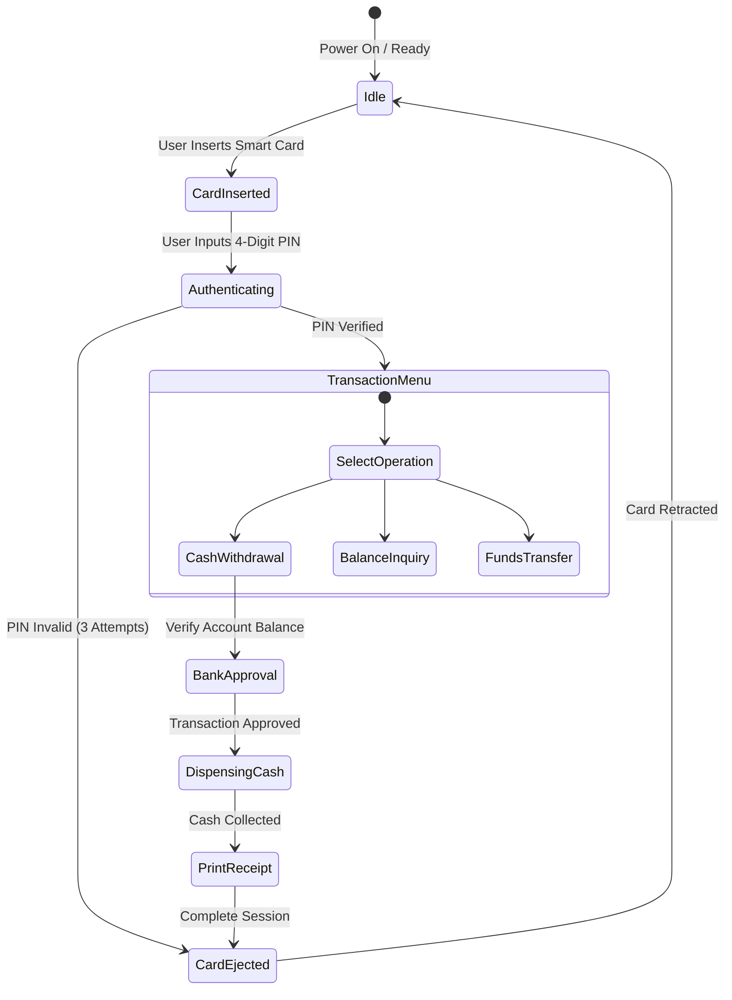

<p align="center">
  
</p>

<p align="center">
  
  
  
  
</p>

<a id="overview"></a>
## 📖 Executive Summary & Overview

Automated Teller Machines (ATMs) are mission-critical, distributed hardware-software systems operating under strict fault-tolerance, concurrency, and security constraints. A single unhandled race condition or unvalidated state transition can lead to financial inconsistencies or hardware malfunction.

This project presents a rigorous **Software Engineering Case Study** detailing the architectural blueprint of an enterprise ATM system. Authored as part of the academic curriculum at Alliance University, the analysis covers **functional decomposition, state transition diagrams, transaction sequence workflows, card reader hardware interfaces, PIN authentication security**, and **cash dispenser hardware reconciliation**.

<a id="toc"></a>
## 📑 Table of Contents

- [📖 Executive Summary & Overview](#overview)
- [🎯 Key Features & Capabilities](#features)
- [🏗️ System Architecture & Pipeline](#architecture)
- [🛠️ Tech Stack Breakdown](#tech-stack)
- [⚙️ Reproducible Quickstart & Setup](#setup)
- [📁 Project Directory Layout](#project-layout)
- [👨‍💻 Author & Contributions](#author)

<a id="features"></a>
## 🎯 Key Features & Capabilities

- **Finite State Machine (FSM) Modeling:** Strict state validation across Idle, Card Inserted, PIN Validating, Transaction Selection, Dispensing, and Session Terminated.
- **Concurrency & Transactional ACIDity:** Protocols preventing race conditions across multi-session bank account updates.
- **Hardware Abstraction Layer (HAL):** Interaction models for the Card Reader, Cash Dispenser, Keypad, and Receipt Printer.
- **Failure Recovery Protocols:** Rollback procedures for power failures, dispenser paper jams, and network timeouts.

<a id="architecture"></a>
## 🏗️ System Architecture & Pipeline



<a id="tech-stack"></a>
## 🛠️ Tech Stack Breakdown

| Domain | Methodologies & Concepts | Focus Areas |
| :--- | :--- | :--- |
| **System Architecture** | Tiered Client-Server Architecture | ATM Client, Bank Switch, Core Banking System (CBS) |
| **Formal Modeling** | UML 2.0 (Use Case, Sequence, State) | Dynamic behavioral workflows and operational boundaries |
| **Security Standards** | PCI-DSS, 3DES/AES PIN Encryption | End-to-end payload encryption and session hashing |
| **Documentation** | Technical Case Study Report | Architectural specification and risk mitigation |

<a id="setup"></a>
## ⚙️ Reproducible Quickstart & Setup

```bash
# 1. Clone repository
git clone https://github.com/Amaraiah11/CASE-STUDY-ON-ATM-DESINE-Software-Engineering-.git
cd CASE-STUDY-ON-ATM-DESINE-Software-Engineering-

# 2. View Case Study Document
# Open 'AMARAIAH_CASE_STUDY1.pdf' in any standard PDF reader
```

<a id="project-layout"></a>
## 📁 Project Directory Layout

```text
CASE-STUDY-ON-ATM-DESINE-Software-Engineering-/
├── AMARAIAH_CASE_STUDY1.pdf   # Complete software engineering case study document
└── README.md                  # Comprehensive architectural overview and documentation
```

<a id="author"></a>
## 👨‍💻 Author & Contributions

This project is developed and maintained with high technical rigour by **Amaraiah C**, Software Engineer and Data Analytics Practitioner studying Bachelor of Computer Applications (BCA) at Alliance University.

- 🌐 **GitHub:** [@Amaraiah11](https://github.com/Amaraiah11)
- 💼 **LinkedIn:** [Connect on LinkedIn](https://www.linkedin.com/in/amaraiah-c/)
- 📧 **Institutional Contact:** `camaraiahBCA24@ced.alliance.edu.in`

### 🤝 Contribution Guidelines
Contributions, bug reports, and architectural discussions are welcome!
1. **Fork** the repository: `https://github.com/Amaraiah11/CASE-STUDY-ON-ATM-DESINE-Software-Engineering-`
2. **Branch**: `git checkout -b feature/your-feature-name`
3. **Commit**: `git commit -m "feat: enhance feature logic"`
4. **Push**: `git push origin feature/your-feature-name`
5. **Open Pull Request** against the `Amaraiah-C` branch.

---

<p align="center">
  <b>⭐ If this codebase or documentation assisted your engineering workflows, please star the repository! ⭐</b>
</p>

<p align="center">
  
</p>
