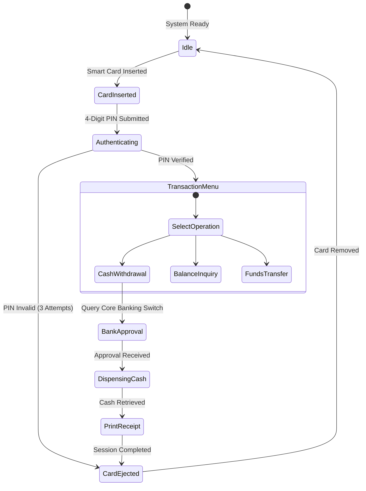

# 🏧 ATM System Design — Software Engineering Architecture Case Study

<p align="center">
  
</p>

<p align="center">
  <b>Comprehensive Software Engineering Blueprint: Distributed Architecture, Finite State Machine (FSM) Modeling, and Hardware Abstraction for Enterprise ATM Networks.</b>
</p>

<p align="center">
  
  
  
  
</p>

<p align="center">
  
</p>

---

<a id="table-of-contents"></a>
## 📌 Table of Contents

- [📖 Executive Summary & Overview](#executive-summary--overview)
- [🎯 Key Features & Capabilities](#key-features--capabilities)
- [🏗️ System Architecture & Pipeline](#system-architecture--pipeline)
- [🛠️ Tech Stack Breakdown](#tech-stack-breakdown)
- [⚙️ Reproducible Quickstart & Setup](#setup)
- [📁 Project Directory Layout](#project-layout)
- [🔮 Future Improvements & Roadmap](#future-improvements--roadmap)
- [🤝 Contributing Guidelines](#contributing-guidelines)
- [👨‍💻 Author & Contributions](#author--contributions)

---

<a id="executive-summary--overview"></a>
## 📖 Executive Summary & Overview

Automated Teller Machines (ATMs) operate in high-risk environments with zero tolerance for hardware desynchronization, unverified card state transitions, or transactional concurrency errors. Developing an enterprise-grade ATM specification requires a formal software engineering case study addressing hardware interfaces, PIN encryption standards, and fail-safe recovery routines.

This project delivers an authoritative **Software Engineering Case Study** authored by **Amaraiah C** at Alliance University. Documented in `AMARAIAH_CASE_STUDY1.pdf`, the specification covers use-case analysis, finite state machines, card reader hardware interfaces, cash dispenser reconciliation, and core banking network switches.

---

<a id="key-features--capabilities"></a>
## 🎯 Key Features & Capabilities

### 🔐 1. Finite State Machine (FSM) Specification
- Rigorous state sequence: Idle $\to$ Card Inserted $\to$ PIN Verification $\to$ Transaction Menu $\to$ Dispensing $\to$ Card Ejected.
- Automated card retention trigger on 3 consecutive invalid PIN entries.

### 🛡️ 2. Transaction Concurrency & ACID Integrity
- Distributed locking protocols preventing race conditions across simultaneous multi-ATM withdrawals.

### 🖨️ 3. Hardware Abstraction Layer (HAL)
- Architectural interfaces for Card Readers, Keypads, Cash Dispensers, and Thermal Printers.

---

<a id="system-architecture--pipeline"></a>
## 🏗️ System Architecture & Pipeline



---

<a id="tech-stack-breakdown"></a>
## 🛠️ Tech Stack Breakdown

| Domain | Methodologies & Standards | Focus Areas |
| :--- | :--- | :--- |
| **System Architecture** | Tiered Client-Server Architecture | ATM Client, Bank Switch, Core Banking System (CBS) |
| **Formal Modeling** | UML 2.0 (Use Case, Sequence, State) | Dynamic behavioral workflows and operational boundaries |
| **Security Standards** | PCI-DSS, 3DES/AES PIN Encryption | End-to-end payload encryption and session hashing |
| **Documentation** | Academic Technical Case Study (`.pdf`) | Formal engineering specification |

---

<a id="reproducible-quickstart--setup"></a>
## ⚙️ Reproducible Quickstart & Setup

```bash
# 1. Clone repository
git clone https://github.com/Amaraiah11/CASE-STUDY-ON-ATM-DESINE-Software-Engineering-.git
cd CASE-STUDY-ON-ATM-DESINE-Software-Engineering-

# 2. View Case Study Document
# Open 'AMARAIAH_CASE_STUDY1.pdf' in any standard PDF reader
```

---

<a id="project-directory-layout"></a>
## 📁 Project Directory Layout

```text
CASE-STUDY-ON-ATM-DESINE-Software-Engineering-/
├── AMARAIAH_CASE_STUDY1.pdf   # Complete software engineering case study document
└── README.md                  # Comprehensive architectural overview and documentation
```

---

<a id="future-improvements--roadmap"></a>
## 🔮 Future Improvements & Roadmap

- [ ] Model contactless NFC / biometric authentication workflows.
- [ ] Add Java reference implementation of the ATM state machine.

---

<a id="author--contributions"></a>
## 👨‍💻 Author & Contributions

This project is developed and maintained with rigorous engineering standards by **Amaraiah C**, Software Developer and Applied Data Analytics Practitioner studying Bachelor of Computer Applications (BCA) at Alliance University, Bangalore.

- 🌐 **GitHub Profile:** [@Amaraiah11](https://github.com/Amaraiah11)
- 💼 **LinkedIn Profile:** [Connect on LinkedIn](https://www.linkedin.com/in/amaraiah-c/)
- 📧 **Institutional Email:** `camaraiahBCA24@ced.alliance.edu.in`

### 🤝 Contributing Guidelines
Contributions, bug reports, and architectural discussions are welcome!
1. **Fork** the repository: `https://github.com/Amaraiah11/CASE-STUDY-ON-ATM-DESINE-Software-Engineering-`
2. **Create a Feature Branch:**
   ```bash
   git checkout -b feature/your-feature-name
   ```
3. **Commit Your Enhancements:**
   ```bash
   git commit -m "feat: enhance feature logic"
   ```
4. **Push to Your Branch:**
   ```bash
   git push origin feature/your-feature-name
   ```
5. **Open a Pull Request** against the `Amaraiah-C` branch.

---

<p align="center">
  <b>⭐ If this codebase or documentation assisted your engineering workflows, please star the repository! ⭐</b>
</p>

<p align="center">
  
</p>
